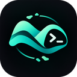

<p align="center">
  
</p>

<h1 align="center">NusaShell</h1>

<p align="center"><strong>Your AI workspace, on your machine.</strong><br>
Bring models and coding agents into one place. Give every conversation its project, tools, and a home in the browser — or meet it in chat.</p>

<p align="center">
  <a href="https://jahrulnr.github.io/NusaShell/">Read the NusaShell Guide</a> ·
  <a href="https://github.com/jahrulnr/NusaShell">GitHub repository</a>
</p>

<p align="center">
  <a href="LICENSE"></a>
  <a href="go.mod"></a>
</p>

---

NusaShell is a local workspace for working with AI. Use an API model or an ACP-compatible agent in the same conversation space, keep work grouped by project, and follow each turn from a live web interface. Connect WhatsApp or Telegram when you want to talk from chat, or let an automation start a conversation on a schedule.

## One workspace, your choice of runtime

- **Models and agents side by side.** Connect an API provider such as OpenAI, Anthropic, Gemini, OpenRouter, or Ollama, or use a coding agent that speaks the [Agent Client Protocol](https://agentclientprotocol.com/). Choose the runtime for each conversation.
- **A clear view of the work.** Follow responses as they stream, inspect reasoning and tool activity, and handle agent approval requests in the web interface.
- **Projects with real context.** Group conversations around your work and bind each project to the folders the model or agent should use.
- **Meet the conversation in chat.** Link WhatsApp or Telegram and continue the same work across the web and chat, with control over where replies go.
- **Let routine work run.** Schedule one-time or recurring prompts and revisit each run in its conversation.
- **Local by design.** NusaShell runs as a single binary on your computer, with an embedded web interface and local conversation storage. Connect the model endpoints and agent tools that fit your setup.

## Get started

### Install a release

**Linux**

```bash
curl -fsSL https://raw.githubusercontent.com/jahrulnr/NusaShell/master/scripts/install.sh | bash
```

**Windows** (PowerShell)

```powershell
irm https://raw.githubusercontent.com/jahrulnr/NusaShell/master/scripts/install.ps1 | iex
```

The installer downloads the latest release and verifies its SHA-256 checksum. Start NusaShell with `nusashell` and open the local address it prints (default: <http://127.0.0.1:10994>).

### Build from source

Requires the Go version declared in [`go.mod`](go.mod).

```bash
make build
./bin/nusashell onboard
./bin/nusashell
```

Open <http://127.0.0.1:10994> and connect a provider or agent to begin.

## Explore

- [NusaShell Guide](https://jahrulnr.github.io/NusaShell/) — tutorials for setting up models, agents, projects, chat channels, browser tools, and automations
- [Architecture](docs/architecture.md) — how conversations, models, agents, and tools work together
- [CLI guide](docs/cli-guide.md) — setup, providers, agents, and running NusaShell as a service
- [Adapters](docs/adapters.md) — provider connections and tools
- [WebUI API contract](docs/api/contract.md) — HTTP and WebSocket interface
- [All documentation](docs/README.md)

## License

NusaShell is licensed under the [GNU General Public License v3.0](LICENSE).
