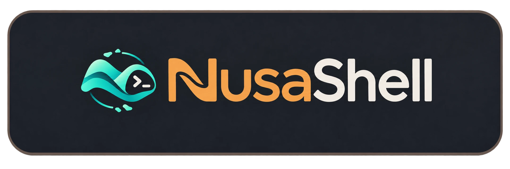

# Welcome to NusaShell

NusaShell is a local workspace for AI conversations. Bring API models and ACP-compatible agents into the same place, give work a project and folders, and continue conversations from the web, WhatsApp, or Telegram.

## Start with a working conversation

Follow these short tutorials in order. You will install NusaShell, connect one runtime, and send your first message.

1. [Install and open NusaShell](tutorials/first-run.md)
2. [Connect an API model](tutorials/connect-a-model.md) or [use an ACP agent](tutorials/use-an-agent.md)
3. [Start a conversation and choose its runtime](tutorials/connect-a-model.md#choose-a-model)

## Then make it yours

- Keep related conversations and working folders together with [projects](tutorials/projects-and-folders.md).
- Continue work from [WhatsApp or Telegram](tutorials/chat-channels.md).
- Let a conversation use the [built-in browser](tutorials/browser.md).
- Start recurring work with [automations](tutorials/automations.md).

## How NusaShell fits together

A conversation is the shared workspace. Choose a provider and model, or an ACP agent, for each turn. NusaShell keeps the transcript and project context while the selected runtime produces the answer and uses its available tools.

The [reference guides](cli-guide.md) explain setup and the command line. If you want to understand or extend the implementation, start with [architecture](architecture.md).

## About this guide

These pages describe the released behavior in this repository. The guides are written and reviewed alongside the product; GitHub Actions checks the documentation build on pull requests and publishes updates to GitHub Pages after changes reach `master`.
