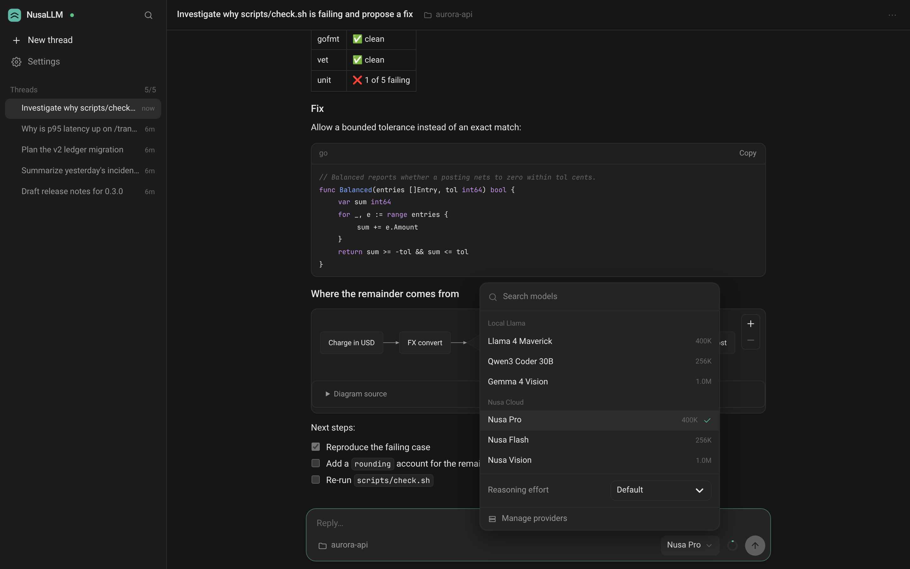

# Connect an API model

Use a provider when you want NusaShell's model runtime to call an API endpoint. The endpoint may be hosted by a provider or run locally on your machine.

## Add a provider

On first run, choose **Connect a provider** and pick a preset, or add a compatible endpoint. To add another provider later, open **Settings → Providers**.

You will need:

- A provider ID and endpoint URL.
- An API key if the endpoint requires one.
- At least one model ID supported by that endpoint.

For example, Ollama's OpenAI-compatible endpoint is commonly available at `http://127.0.0.1:11434/v1`. Use the model ID shown by your Ollama installation. Hosted providers usually give you the endpoint, key, and model IDs in their API settings.

## Choose a model

1. Start a new conversation.
2. Open the runtime picker above the message composer.
3. Expand the provider and select a model.
4. Send a short message and check that the assistant replies.

The picker can also select configured ACP agents. A conversation keeps its runtime binding, and you can switch it for a later turn.

## Common connection problems

- **Authentication error:** check that the key is current and belongs to the provider you selected.
- **Unknown model:** copy the model ID exactly as the endpoint reports it.
- **Local endpoint unreachable:** make sure its server is running and its address is reachable from the machine running NusaShell.
- **Need endpoint-specific settings:** see [provider adapters](../adapters.md) and the [CLI guide](../cli-guide.md).

Next: [send your first message](first-run.md#first-run-checklist), [use an ACP agent](use-an-agent.md), or [organize work into projects](projects-and-folders.md).
